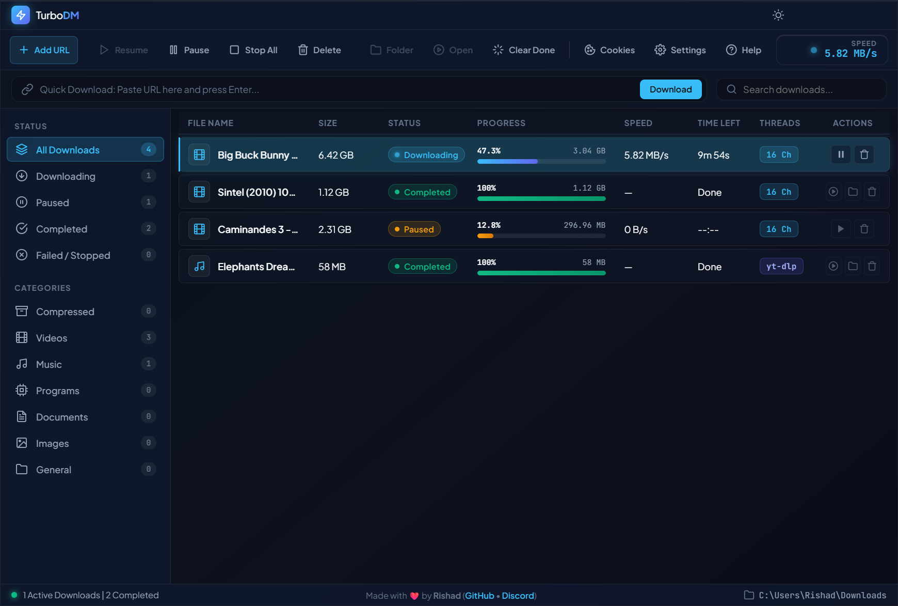
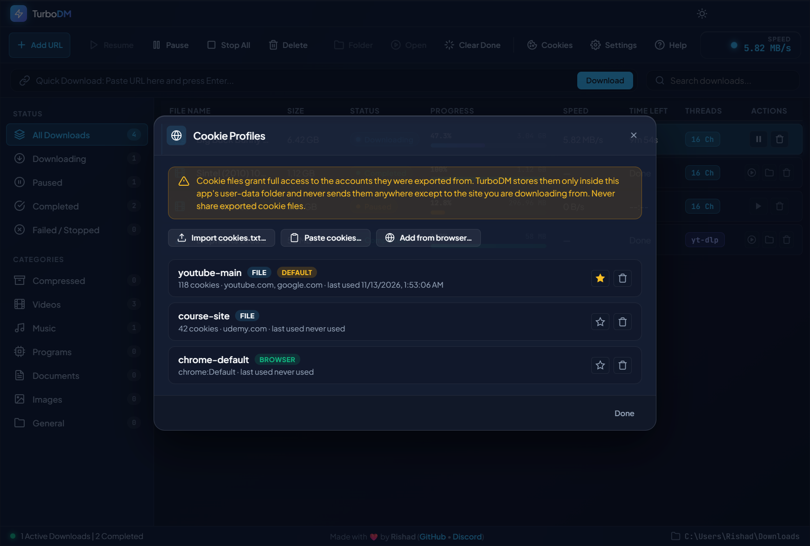
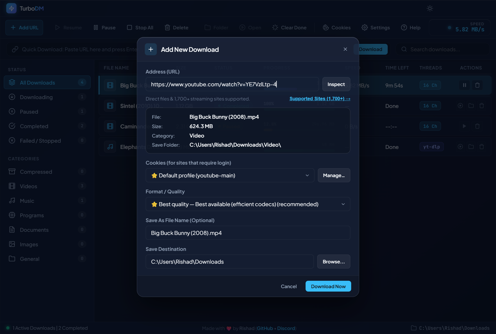
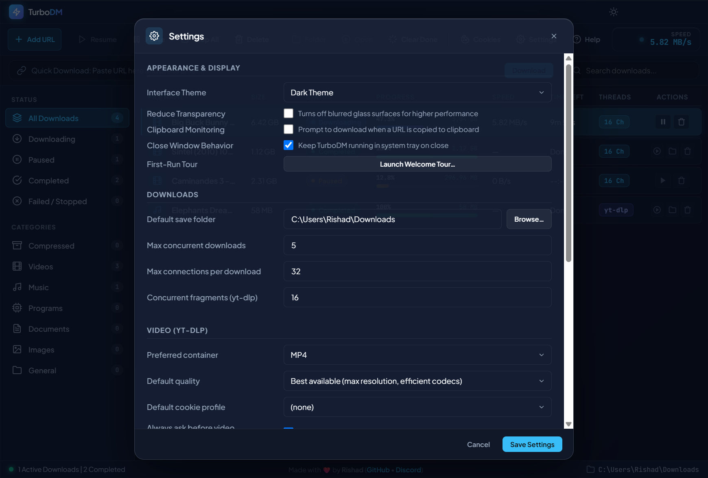

# TurboDM

Download manager for Windows. Direct files download over many parallel connections; videos and streams from 1000+ sites (YouTube, TikTok, Instagram, Twitch and everything else yt-dlp supports) go through a managed yt-dlp engine with format and quality selection.

<p align="center"></p>

## Install

Both builds work on Windows 10 and 11 (64-bit). No runtime dependencies — everything the app needs downloads itself on first use.

### Installer

1. Download `TurboDM-Setup-1.0.0.exe` from the [Releases](../../releases) page.
2. Windows SmartScreen will say "unknown publisher" — click **More info → Run anyway**. The app is open source but not code-signed.
3. Follow the wizard. It installs per-user (no admin), creates Start menu and desktop shortcuts, and launches when done.
4. Uninstalling from Windows Settings leaves your download history and cookie profiles in `%APPDATA%\turbodm` — delete that folder too if you want everything gone.

### Portable

1. Download `TurboDM 1.0.0.exe`.
2. Put it anywhere and run it. Nothing is installed.
3. Same SmartScreen step as above. First launch takes a second longer because the exe unpacks itself.

Both builds keep their data in the same place (`%APPDATA%\turbodm`), so you can switch between them without losing your download list, settings, or cookie profiles.

## Cookies

Sites that require login — age-gated videos, members-only content, private files — need your browser cookies. TurboDM has a cookie manager with two ways to add them.

### Option 1 — Export with a browser extension (recommended)

This works on every browser, including new Chrome and Edge versions that block other tools from reading cookies.

1. Install a cookie export extension in your browser:
   - Chrome / Edge: **Cookie-Editor** or **Get cookies.txt LOCALLY**
   - Firefox: **Cookie-Editor** or **cookies.txt**
2. Log in to the site you want to download from.
3. Open the extension while on that site and export in **Netscape** format (`cookies.txt`). In Cookie-Editor, use **Export → Netscape**. Get cookies.txt LOCALLY exports Netscape with one click.
4. In TurboDM, open **Cookies** in the toolbar and either **Import cookies.txt** (pick the file) or **Paste cookies** (open the file in Notepad, copy everything, paste it in).
5. Give the profile a name that tells you which site it is — `youtube-main`, `course-site` — and save.
6. Star it to make it the default, or pick it per download in the cookie dropdown of the download dialog.

<p align="center"></p>

### Option 2 — Read directly from your browser

Cookies → **Add from browser** → pick the browser (and profile, e.g. `chrome:Profile 1`). The browser must be **fully closed**, including its tray icon. This fails on newer Chrome/Edge (app-bound encryption) — if it does, use Option 1.

> A cookie file is a full login to that account. Never share one. TurboDM stores profiles only in `%APPDATA%\turbodm\cookie-profiles` and sends them nowhere except the site you download from.

## Downloading

Paste a URL in the top bar and press Enter, click **Add** (`Ctrl+N`), drag links or a `.txt` file full of links onto the window, or just copy a link — TurboDM notices the clipboard and offers to download it.

- Direct files start immediately, split across up to 64 connections. Files of 5 MB and up always use at least 16, so per-connection server limits don't slow you down.
- Video and stream URLs open a dialog first: pick the cookie profile, pick a format (resolution and size shown), then download. Audio-only is one click.
- Finished files land in your save folder under a category subfolder — `Video`, `Music`, `Documents`, `Compressed`, `Programs`, `Images`, or `General`.

<p align="center"></p>

Pause and resume anything, any number of times — progress survives pausing, closing the app, and crashes. Closing the window keeps TurboDM running in the tray; use **Exit** in the tray menu to quit for real.

## Settings

<p align="center"></p>

Worth knowing:

| Setting | Notes |
|---|---|
| Max connections per download | Up to 64. Higher helps when a server limits each connection; does nothing when the server or your line is the limit. |
| Max concurrent downloads | How many run at once, up to 10. |
| Concurrent fragments | For yt-dlp streams (HLS/DASH), up to 32. |
| yt-dlp channel | `stable` normally; `nightly` when a site broke and the fix just landed. |
| Proxy | Applies to yt-dlp downloads only. |
| Reduce transparency | Turns off the glass and acrylic effects — use it on weak GPUs or for screen recording. |

## Keeping video sites working

Sites change constantly and yt-dlp updates to keep up. If a video suddenly fails with an extraction error: **Settings → yt-dlp → Check & Update**, or switch the channel to `nightly` and update again. The binary is managed by TurboDM (verified against yt-dlp's official SHA-256 checksums), so updates are one click.

## Keyboard shortcuts

| Key | Action |
|---|---|
| `Ctrl+N` | New download |
| `Ctrl+,` | Settings |
| `F1` | Help |
| `↑` / `↓` | Move through the list |
| `Space` | Pause / resume the selected download |
| `Enter` | Open the finished file |
| `Delete` | Remove from the list |
| `Esc` | Close dialogs |

## Troubleshooting

- **"Sign in to confirm" / members-only errors** — add a cookie profile for that site (see Cookies above).
- **"The browser's cookie database is locked"** — close that browser completely, including the tray, and retry. Or use Option 1.
- **Cookie export fails on Chrome/Edge** — newer versions encrypt cookies; the app can't read them. Use the extension method.
- **A video that used to work now fails** — update yt-dlp (Settings → yt-dlp), or try the nightly channel.
- **HTTP 429 / rate limited** — the server is throttling you. Wait a while, or download with a cookie profile for that site.
- **Download slower than expected** — your line or the server is the limit, not the connection count. Compare with a speed test.
- **Window looks plain / glass effects missing** — Settings → Reduce transparency is on, or your GPU driver dropped out.

## Building from source

Requires [Bun](https://bun.sh) v1.1+ (development only — the built app doesn't need it).

```bash
bun install
bun start          # run the app
bun test           # test suite, no Electron required
bun run dist       # NSIS installer + portable exe into dist/
```

## Author

Rishad — [github.com/rishad0x](https://github.com/rishad0x)
